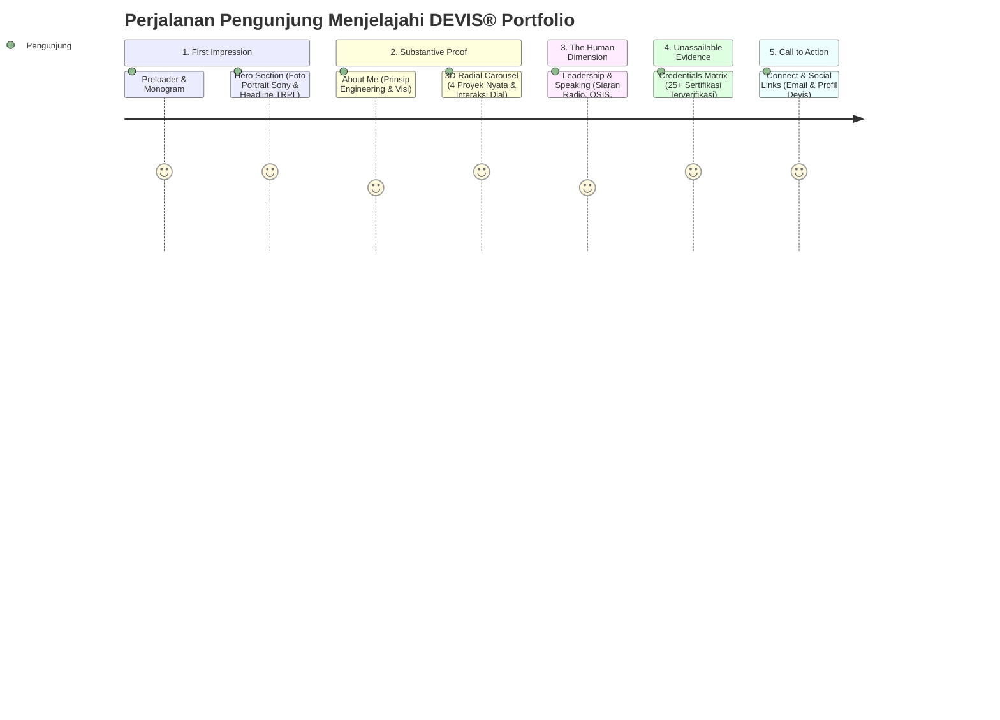

# CONTENT STRUCTURE & USER JOURNEY SPECIFICATION
**Project:** DEVIS® Personal Portfolio  
**Stage:** 04 - Content Structure & Mapping  
**Kandidat:** Abu Devis Jalaluddin Rumi (`DEVIS®`)  
**Palet Terkunci:** 90% Pure Monochrome Arsitektural + 10% Electric Crimson (Jarum Rotary Dial & Micro-Badge Aktif)  

---

## 1. Urutan Storytelling (The Narrative Arc)

Alur narasi dirancang mengikuti psikologi penilai akademik dan rekruter industri dalam 5 babak logis:

1. **Babak 1: "Who is DEVIS?" (First Impression)**  
   Pengunjung langsung disambut oleh visual berwibawa: foto portrait Sony Alpha beresolusi tinggi, monogram `DEVIS®`, dan status mahasiswa TRPL Politeknik IDN Angkatan 5. Tanpa embel-embel, tegas, dan berkelas.
2. **Babak 2: "What Can He Build?" (Core Engineering Capability)**  
   Pengunjung langsung diajak berinteraksi dengan 3D Radial Arc Carousel. Memutar dial bawah untuk melihat CapyQuest (Bun/Hono), BASOKU (Laravel/Livewire), dan Setoran Companion (Lovable Tahfidz). Bukti kode nyata mendahului klaim kata-kata.
3. **Babak 3: "How Does He Lead & Communicate?" (Human Leadership)**  
   Menampilkan dimensi pembeda: pengalaman sebagai MC/Broadcaster siaran radio *Santri Mengudara*, Sekretaris & Bendahara Umum OSIS, serta Ketua Panitia *Bazaar Amal Manaahel*.
4. **Babak 4: "Is He Consistent & Verified?" (Depth of Learning)**  
   Pameran 25+ sertifikat terverifikasi (SantriKoding, Bisa.AI, Linux Foundation, Microsoft Fabric, Syahadah Tahfidz). Membuktikan konsistensi dan etos belajar tinggi.
5. **Babak 5: "How Do We Collaborate?" (Frictionless Contact)**  
   Saluran komunikasi instan: tombol salin email satu klik, tautan GitHub, LinkedIn, dan Instagram resmi `@adevss_`.

---

## 2. Pemetaan Konten Mendalam per Seksi (Content Mapping)

### Seksi 01: Preloader & Brand Identity
- **Nama Komponen:** `BrandPreloader`
- **Tujuan:** Menghilangkan flicker muat halaman (*Flash of Unstyled Content*) sembari menginisialisasi rotasi awal 3D.
- **Pesan Utama:** "Presisi, minimalis, dan terkalibrasi."
- **Konten:** Tipografi kinetik bertuliskan `DEVIS® • TRPL-05 • 2026`, persentase aset termuat (0% → 100%).
- **Aset Visual:** Vector monogram `DEVIS®`.
- **Interaksi:** Masking curtain slide-up saat loading selesai.

---

### Seksi 02: Hero Section (The Technical Identity)
- **Nama Komponen:** `HeroSection`
- **Tujuan:** Menetapkan identitas profesional dalam 3 detik pertama kunjungan.
- **Pesan Utama:** Calon Software Engineer dan Tech Entrepreneur dengan fondasi teknis kuat.
- **Konten Ditampilkan:**
  - Wordmark raksasa: `DEVIS®`
  - Tagline: *Software Engineering Student & Aspiring Tech Entrepreneur*
  - Badge Status: `TRPL POLITEKNIK IDN BOGOR • ANGKATAN 5 • SEMESTER 1`
  - Quick Metric: `4 SHOWCASE PROJECTS • 25+ CERTIFICATIONS • EST. 2026`
- **Aset Visual:** `hero-portrait-devis` (Sony Alpha `Downloads/DSC04315.JPG`, WebP responsif monokrom).
- **CTA:** Tombol *[Explore Works]* (smooth scroll ke seksi 3D Carousel).
- **Interaksi:** Cursor-follow parallax pada foto portrait, split-text staggered reveal pada headline.

---

### Seksi 03: About & Engineering Mindset
- **Nama Komponen:** `AboutSection`
- **Tujuan:** Menyampaikan filosofi kerja dan bidang keahlian tanpa narasi CV bertele-tele.
- **Pesan Utama:** Rekayasa perangkat lunak bukan sekadar menulis baris kode, melainkan menyelesaikan masalah nyata dengan arsitektur efisien.
- **Konten Ditampilkan:**
  - Bio Ringkas: Perjalanan dari Lumajang Jawa Timur hingga mendalami rekayasa sistem di Politeknik IDN Bogor.
  - Tiga Pilar Utama:
    1. *Fullstack Architecture:* Menguasai arsitektur modern (Bun, Hono, React, Laravel, REST API, Database Relasional).
    2. *Clear Articulation:* Mampu mengomunikasikan ide teknis yang kompleks menjadi narasi yang mudah dipahami.
    3. *Execution Leadership:* Berpengalaman mengorganisir tim, memimpin kepanitiaan amal, dan mengelola tata kelola organisasi.
- **Aset Visual:** Foto informal editorial saat studi/kegiatan kampus.
- **CTA:** Unduh Curriculum Vitae format PDF `[Download Résumé]`.

---

### Seksi 04: Selected Works (3D Radial Arc Carousel)
- **Nama Komponen:** `WorksCarousel3D`
- **Tujuan:** Memberikan pengalaman interaktif paling berkesan dalam menjelajahi karya unggulan.
- **Pesan Utama:** Mahasiswa yang produktif menghasilkan produk perangkat lunak fungsional dan teruji.
- **Daftar Kartu 3D:**
  1. **DEVIS® Interactive 3D Portfolio:** Creative Web, CSS 3D Transforms, GSAP, Responsive System.
  2. **CapyQuest – Habit RPG:** Fullstack Bun runtime, Hono API, React 19, `bun:sqlite` database native.
  3. **BASOKU – F&B Management System:** Laravel, Livewire, MySQL, ERD Relasional, Smart Recipe Calculator.
  4. **Setoran Companion – Tahfidz Cloud:** React, Tailwind CSS, Lovable Platform, Realtime Santri Progress.
- **Aset Visual:**
  - Mockup & thumbnail resmi masing-masing proyek (`thumbnail_1048x700.jpg`, diagram ERD `dbdiagram-devis_page-0001.jpg`).
- **Elemen Kontroler:**
  - *Bottom Rotary Dial:* Busur radial dengan jarum penunjuk aktif bertinta **Electric Crimson** (`#e63946`).
  - Label dinamis: Menampilkan nama proyek aktif secara real-time mengikuti perputaran dial.
- **CTA:** Tombol *[Inspect Architecture]* (membuka drawer modal teknis per proyek).

---

### Seksi 05: Leadership & Public Speaking
- **Nama Komponen:** `LeadershipSection`
- **Tujuan:** Membuktikan kemampuan komunikasi publik, kepemimpinan, dan kecerdasan sosial.
- **Pesan Utama:** Kemampuan komunikasi artikulatif memperkuat efektivitas kepemimpinan teknis.
- **Konten Ditampilkan:**
  - **Item 01: Acara Siaran Radio "Santri Mengudara"**  
    *Peran:* MC & Radio Broadcaster. Memandu siaran radio edukatif langsung dan interaksi pendengar.
  - **Item 02: BPH OSIS – Organisasi Siswa/Santri**  
    *Peran:* Sekretaris & Bendahara Umum. Mengelola tata administrasi dan keuangan organisasi lintas divisi.
  - **Item 03: Bazaar Amal Manaahel**  
    *Peran:* Ketua Panitia Pelaksana. Mengoordinasikan seluruh logistik, perizinan, dan alokasi dana sosial.
  - **Item 04: Lomba Pidato Pekan Ukhuwwah**  
    *Peran:* Finalis & Orator Publik. Orasi kepemudaan dan solidaritas.
- **Aset Visual:** `MC acara Santri Mengudara.jpeg`, `Acara Siaran Radio.jpeg`, `Bazaar Amal Manaahel.jpeg`, `Foto Bersama Para Ketua Divisi Osis.jpeg`.
- **Interaksi:** Asymmetric editorial grid dengan hover preview gambar dokumentasi kegiatan.

---

### Seksi 06: Credentials Matrix (25+ Sertifikasi Terverifikasi)
- **Nama Komponen:** `CredentialsMatrix`
- **Tujuan:** Memberikan bukti tak terbantahkan mengenai kedalaman belajar dan keahlian teknis.
- **Pesan Utama:** Komitmen belajar berkelanjutan yang dibuktikan melalui 25+ sertifikasi terakreditasi industri.
- **Struktur Kategori Filter:**
  - `[ALL (25+)]`
  - `[SOFTWARE ENGINEERING]` (SantriKoding Bun/Hono/React, Golang, Rust, Next.js, Express, Bisa.AI Laravel).
  - `[AI & SYSTEMS]` (Microsoft Fabric AI Foundations, Linux Foundation Open Source & CS).
  - `[CHARACTER & LANGUAGE]` (Syahadah Tahfidz Al-Qur'an, Sertifikat Dauroh Bahasa Arab).
- **Aset Dokumen:** Berkas PDF terverifikasi dari direktori `Documents/sertifikat kuliah/`.
- **CTA:** Klik kartu sertifikat untuk membuka *Certificate Viewer Modal Drawer* (menampilkan institusi, tanggal terbit, dan nomor credential).

---

### Seksi 07: Connect & Social Network
- **Nama Komponen:** `ContactSection`
- **Tujuan:** Menghilangkan friksi bagi dosen, mitra industri, dan kolaborator untuk menghubungi Devis.
- **Pesan Utama:** Terbuka untuk diskusi proyek rekayasa perangkat lunak, kolaborasi teknologi, dan kesempatan magang.
- **Konten & Aksi:**
  - Email Primer: `abudevis5@gmail.com` (disertai tombol *[Copy Email Address]* dengan feedback visual animasi centang).
  - Profil GitHub: `github.com/DevisRoomi` (menampilkan direct link ke repositori terbuka).
  - Profil LinkedIn: `linkedin.com/in/abu-devis-jalaluddin-rumi-5475a33b6/`.
  - Profil Instagram: `@adevss_` (`instagram.com/adevss_/`).
- **Aset:** Ikon monokrom presisi (Lucide Icons: `Mail`, `Github`, `Linkedin`, `Instagram`, `Copy`).

---

### Seksi 08: Footer Colophon
- **Nama Komponen:** `SiteFooter`
- **Konten:**
  - Wordmark: `DEVIS® ARCHITECTURE & DESIGN SYSTEM`
  - Copyright: `© 2026 Abu Devis Jalaluddin Rumi. All rights reserved.`
  - Stack Credit: `Built with Bun 1.4, React, Vite, Tailwind CSS & GSAP.`
  - Anchor: Tombol *[Back to Top ↑]* dengan inertia easing.

---

## 3. Matriks Adaptasi Responsif Lintas Perangkat

| Elemen Antarmuka | Desktop (≥ 1024px) | Tablet (768px - 1023px) | Mobile (< 768px) |
|---|---|---|---|
| **Sistem Navigasi** | Floating Pill Bar lengkap dengan 5 link teks & indikator section | Floating Pill Bar minimalis berjarak rapat | Sticky Bar minimalis (Wordmark + Quick Action Drawer) |
| **Hero Section** | Komposisi asimetris 2 kolom (Teks Kiri + Foto Portrait Kanan berskala besar) | Komposisi bertingkat dengan foto portrait terpusat | Stack vertikal elegan, foto portrait aspek 4:5 dengan gradasi bayangan |
| **Works 3D Carousel** | 3D Radial Arc Carousel penuh dengan Bottom Rotary Dial dan drag/wheel 3D | 3D Carousel berskala 80% dengan rotary dial responsif sentuh | **Horizontal Touch Swipe Card Stack** dengan indicator dots taktil (menjamin 60 FPS di ponsel) |
| **Rotary Dial** | Dial busur penuh dengan radial ticks presisi dan jarum merah crimson | Dial busur proporsional | Dial disederhanakan menjadi radial arc pagination tracker |
| **Leadership Grid** | Grid editorial 3 kolom asimetris | Grid editorial 2 kolom | Single column card feed berjarak rapi dengan foto rasio 16:9 |
| **Credentials Matrix** | Grid 4 kolom dengan filter tabs | Grid 2 kolom dengan filter scrollable | Single/double column scrollable dengan preview modal drawer |
| **Interaksi Hover** | Efek magnetik, cursor scaling, dan hover tooltip aktif | Hover dimatikan; interaksi dialihkan ke single-tap | Single-tap feedback instan dengan ripple micro-animation |

---

## 4. Status Kelengkapan Konten
- [x] Nama & Profil Lengkap: Abu Devis Jalaluddin Rumi (Tersedia)
- [x] Identitas Akademik: Mahasiswa TRPL Semester 1 Politeknik IDN Angkatan 5 (Tersedia)
- [x] Data 4 Proyek Unggulan: DEVIS Portfolio, CapyQuest, BASOKU, Setoran Companion (Lengkap)
- [x] Dokumentasi Acara Non-Teknis: Siaran Radio, OSIS, Bazaar Manaahel (Lengkap & Terverifikasi)
- [x] Daftar 25+ Sertifikat: SantriKoding, Bisa.AI, Linux, Microsoft, Tahfidz, Bahasa Arab (Lengkap)
- [x] Saluran Kontak & Sosmed: Email, GitHub, LinkedIn, Instagram `@adevss_` (Lengkap)
- **Status:** **100% READY** (Tidak ada bagian yang berstatus *NEEDS INPUT*).
