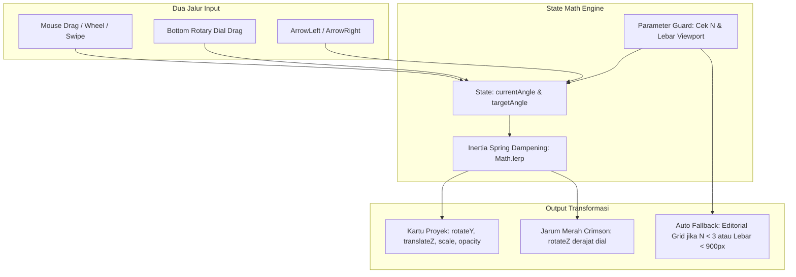

# MOTION & INTERACTION DESIGN SPECIFICATION (FINAL VERIFIED)
**Project:** DEVIS® Personal Portfolio  
**Stage:** 06 - Motion System, 3D Mathematics, Performance & QA  
**Kandidat:** Abu Devis Jalaluddin Rumi (`DEVIS®`)  
**Status:** Approved & Production-Ready  

---

## 1. Prinsip Gerak & Usability Guardrails

1. **Substantive, Not Decorative (Gerak Bermakna & Fungsional)**  
   Setiap animasi dirancang untuk memperjelas arsitektur informasi, hierarki babak, dan memberikan umpan balik taktil. Animasi tidak boleh memperlambat pengguna dalam membaca teks atau menyalin kontak.
2. **Zero Text Distortion (Keterbacaan Utama)**  
   Teks judul, deskripsi proyek, nama institusi, dan narasi kepemimpinan **tidak boleh mengalami distorsi gelombang (*wave distortion*), skew ekstrem, atau blur berkepanjangan**. Teks harus langsung terbaca tajam (*crisp*) begitu masuk viewport.
3. **Graceful Degradation (Anti Rusak Jika JS Mati)**  
   Seluruh elemen penting memiliki status dasar di CSS: `opacity: 1` dan `transform: none`. Kelas animasi (`.js-reveal`, `.orbit-active`) hanya diterapkan setelah JavaScript terbukti aktif dan siap. Jika JavaScript mati atau terjadi network error, website tetap tampil rapi dalam bentuk majalah editorial statis.
4. **Adaptive Input-Aware (Menyesuaikan Perangkat Keras)**  
   Efek magnetik tombol, pelacakan kursor, dan parallax foto **hanya aktif pada perangkat dengan mouse presisi** via kueri `@media (hover: hover) and (pointer: fine)`. Layar sentuh langsung menggunakan interaksi native sentuh bebas lag.

---

## 2. Preloader & Initial Loading Sequence (Critical Asset-Aware)

Preloader tidak bergantung penuh pada `window.load` (menghindari penahanan pengguna akibat pelacak pihak ketiga atau aset non-kritis yang lambat). Preloader berbasis **Critical Assets Ready + Hard Ceiling Timeout**.

```mermaid
sequenceDiagram
    autonumber
    actor User as Pengunjung / Penilai
    participant DOM as HTML & Critical CSS
    participant Engine as Preloader Engine
    participant Critical as Font & Hero Image Promise

    User->>DOM: Akses URL Portfolio
    DOM-->>User: Tampilkan Monogram "DEVIS®" Minimalis (First Paint)
    Engine->>Critical: Cek document.fonts.ready & heroImage.decode()
    alt Aset Kritis Selesai Cepat (<1200ms)
        Critical-->>Engine: Font & Hero Portrait Ready
        Engine->>DOM: Jalankan Curtain Slide-Up Exit (durasi 400ms)
    else Aset Lambat / Jaringan Lemah
        Engine->>Engine: Hard Ceiling Timeout 1400ms tercapai
        Engine->>DOM: Paksa Curtain Slide-Up Exit seketika (Bypass)
    else Pengguna Menekan Tombol Skip
        User->>Engine: Tekan ESC / Tap Tombol [ESC / Skip]
        Engine->>DOM: Hentikan Animasi & Buka Halaman Seketika
    end
    DOM-->>User: Hero Section Terbuka Penuh & Interaktif
```

- **Mekanisme Pelaksanaan:**
  1. **Critical Gate:** Website memantau kesiapan tipografi Syne (`document.fonts.ready`) dan foto portrait hero Sony Alpha (`heroImage.decode()`). Begitu kedua aset kritis ini selesai, tirai preloader langsung meluncur ke atas (*curtain slide-up* 400ms).
  2. **Hard Ceiling Timeout (1400ms):** Jika koneksi lambat, preloader **secara paksa membuka tirai tepat pada 1.4 detik** agar konten utama dapat langsung diakses penilai.
  3. **Aksesibilitas Tombol Skip:**
     - Disediakan tombol monospaced `[ESC / Skip]` di pojok kanan atas.
     - **Keyboard Accessible:** Memiliki `tabindex="0"`, focus outline `2px solid #e63946`, dan terikat ke tombol keyboard `Escape`, `Enter`, dan `Space`.
     - **Touch Accessible:** Target area sentuh minimum 48px × 48px dengan CSS `touch-action: manipulation` untuk responsivitas sentuhan instan.

---

## 3. Matematika 3D Radial Arc Carousel & Sinkronisasi Dua Arah

Arsitektur 3D orbital dihitung secara parametrik untuk mendukung rentang jumlah proyek $N \ge 1$:



### A. Validasi Parametrik Berdasarkan Jumlah Proyek ($N$)

| Jumlah ($N$) | Evaluasi Pembagian Nol & Geometri | Rentang Busur ($\Omega$) | Sudut Antar Kartu ($\Delta	heta$) | Radius ($R$) | Perilaku Layout & Fallback |
|---|---|---|---|---|---|
| **$N = 1$** | $N - 1 = 0$ (Terjadi pembagian nol jika dipaksakan). | $0^\circ$ | $0^\circ$ | $0	ext{px}$ | **Mode Orbital Nonaktif.** Kartu tampil statis di tengah (*single card focus*). Toggle view disembunyikan. |
| **$N = 2$** | $N - 1 = 1$. Aman dari pembagian nol. | $50^\circ$ | $50^\circ$ | $400	ext{px}$ | Kepadatan busur terlalu renggang. **Otomatis fallback ke Editorial Grid 2 Kolom.** |
| **$N = 3$** | $N - 1 = 2$. | $110^\circ$ | $55^\circ$ | $420	ext{px}$ | 1 kartu aktif di tengah, 2 kartu sayap miring $\pm 55^\circ$. Dial needle bergerak antara $-55^\circ$ s.d. $+55^\circ$. |
| **$N = 4$** *(Default)* | $N - 1 = 3$. | $140^\circ$ | $46.67^\circ$ | $460	ext{px}$ | **Kondisi Optimal.** Sudut: $-70^\circ, -23.33^\circ, +23.33^\circ, +70^\circ$. Jarum dial sinkron dari $-60^\circ$ s.d. $+60^\circ$. |
| **$N = 6$** | $N - 1 = 5$. | $150^\circ$ | $30^\circ$ | $650	ext{px}$ | Radius membesar agar kartu selebar 340px tidak bertubrukan. Kartu terluar memudar halus (`opacity: 0.2`). |

### B. Rumus Transformasi Kartu ke-$i$ ($i \in [0, N-1]$)
Jika $N \ge 3$ dan lebar viewport $\ge 900	ext{px}$:
1. Sudut relatif kartu ke-$i$:
   $$\Delta	heta = rac{\Omega}{N - 1}, \quad \phi_i = \left(-rac{\Omega}{2} + i \cdot \Delta	heta
ight) - 	heta_{	ext{offset}}$$
2. Radius Orbital ($R$) dengan lebar kartu $W = 340	ext{px}$:
   $$R = rac{W}{2 \cdot \sin(\Delta	heta / 2)}$$
3. Skala ($s_i$) & Opacity ($lpha_i$):
   $$s_i = \max\left(0.72, \ 1.0 - 0.28 \cdot \left|rac{\phi_i}{\Omega/2}
ight|
ight)$$
   $$lpha_i = \max\left(0.2, \ 1.0 - 0.8 \cdot \left|rac{\phi_i}{\Omega/2}
ight|
ight)$$
4. Transformasi CSS:
   $$	ext{transform} = 	ext{rotateY}(\phi_i) \ 	ext{translateZ}(R) \ 	ext{scale}(s_i)$$

### C. Responsivitas Viewport & Auto-Fallback Rule
- **Threshold Ruang:** Jika lebar layar `< 900px` atau $N < 3$, sistem **secara otomatis menonaktifkan kalkulasi 3D orbital** dan mengalihkan antarmuka ke **Editorial Grid / Touch Swipe Stack**.
- Hal ini mencegah kartu terpotong di tepi layar laptop kecil atau tablet vertikal.

---

## 4. Fitur Toggle: [ORBITAL 3D / EDITORIAL GRID] (Disetujui)

Disediakan tombol toggle arsitektural pada sub-header seksi proyek:

```text
[01 / SELECTED ENGINEERING WORKS]             [ VIEW: ● ORBITAL 3D  |  ⊞ EDITORIAL GRID ]
```

- **State 1 (Orbital 3D):** Menampilkan busur radial 3D interaktif dan bottom rotary dial controller.
- **State 2 (Editorial Grid):** Carousel dan dial bertransisi halus (*crossfade 250ms*) menjadi **Grid Editorial 2 Kolom Asimetris**. Keempat proyek (DEVIS Portfolio, CapyQuest, BASOKU, Setoran Companion) tampil terbuka secara bersamaan lengkap dengan thumbnail, arsitektur stack, dan tautan demo langsung.
- Preferensi tampilan disimpan di `sessionStorage` sehingga pilihan pengunjung tetap konsisten selama sesi penjelajahan.

---

## 5. Device Capability Detection (Guardrails Interaksi Presisi)

Efek hover magnetik, pelacakan kursor, dan parallax foto **hanya diaktifkan jika peramban mendeteksi perangkat penunjuk presisi (mouse/trackpad)**.

```css
/* Efek magnetik dan kursor custom HANYA untuk desktop dengan mouse */
@media (hover: hover) and (pointer: fine) {
  .btn-magnetic {
    transition: transform 200ms cubic-bezier(0.16, 1, 0.3, 1);
  }
  .hero-portrait-frame {
    will-change: transform;
  }
}

/* Pada perangkat layar sentuh / mobile: matikan perhitungan mouse hover */
@media (hover: none) or (pointer: coarse) {
  .btn-magnetic {
    transform: none !important;
  }
  .custom-cursor {
    display: none !important;
  }
}
```

---

## 6. Navigasi & Motion Tokens Matematis

1. **Back to Top:**
   - Standar native: `window.scrollTo({ top: 0, behavior: prefersReducedMotion ? 'auto' : 'smooth' })`.
   - Easing arsitektural: `cubic-bezier(0.65, 0, 0.35, 1)`.
2. **Scroll Progress Indicator:**
   - Garis hairline 1px di bawah navbar meluas secara horizontal dari `0%` ke `100%` seiring penambahan nilai scroll dokumen.
3. **Kinetic Typography (Marquee Divider):**
   - Marquee teks teknis berjalan kontinu via CSS GPU transform `translate3d(-50%, 0, 0)`.
4. **Section Reveal:**
   - Transisi masuk standar `.reveal-in`: `opacity: 1`, `transform: translateY(0)`, durasi 600ms `cubic-bezier(0.16, 1, 0.3, 1)`.

---

## 7. Strategi Profiling & VRAM Management

1. **Aturan Manajemen VRAM (Anti Memory Leak):**
   - `will-change: transform` **hanya diinjeksi saat interaksi drag aktif** (`pointerdown` / `touchstart`), dan dicabut kembali setelah animasi inersia berhenti (`transitionend`).
   - Kontainer kartu 3D menerapkan `backface-visibility: hidden` dan `contain: paint layout`.
2. **Simulasi Hardware Nyata:**
   - Pengujian wajib pada Chrome DevTools dengan *4x CPU Slowdown* untuk menjamin frame rate tidak drop di bawah 55 FPS pada prosesor hemat daya.

---

## 8. Standar Ambang Batas Performa (Core Web Vitals)

Sistem membedakan secara tegas antara ambang batas kepatuhan resmi Google dan target rekayasa internal:

| Metrik Core Web Vitals | Ambang Batas Resmi Google (Pass Threshold) | Target Internal Rekayasa DEVIS® | Strategi Pencapaian |
|---|---|---|---|
| **Largest Contentful Paint (LCP)** | **≤ 2.5 Detik** | **≤ 1.8 Detik** | Foto hero dikompresi WebP tajam + preload font Syne lokal. |
| **Interaction to Next Paint (INP)** | **≤ 200 ms** | **≤ 80 ms** | Drag 3D dan dial murni diproses via CSS transform tanpa re-render React. |
| **Cumulative Layout Shift (CLS)** | **≤ 0.10** | **= 0.00** | Semua kontainer gambar dan kartu 3D memiliki `aspect-ratio` eksplisit. |

---

## 9. Motion Quality Assurance (QA) Checklist

| Kategori Pengujian | Syarat Kelulusan (Pass Criteria) | Status |
|---|---|---|
| **1. Desktop Matrix** | 60 FPS pada Chrome, Edge, Firefox, dan Safari; rotasi 3D bebas tearing. | WAJIB |
| **2. Mobile & Touch** | Gestur sentuh responsif; auto-fallback ke Editorial Grid jika lebar layar <900px. | WAJIB |
| **3. Keyboard Navigation** | Tombol `Tab` fokus jelas dengan outline `2px solid #e63946`; tombol `ArrowLeft` / `ArrowRight` memutar proyek; tombol `ESC` menutup modal drawer dan preloader. | WAJIB |
| **4. Reduced Motion** | Jika `@media (prefers-reduced-motion: reduce)` aktif, animasi 3D dan parallax dinonaktifkan seketika. | WAJIB |
| **5. Kegagalan JavaScript** | Konten utama 100% tampil rapi dalam bentuk editorial statis jika JS dinonaktifkan. | WAJIB |
| **6. Kegagalan Aset / Jaringan** | Placeholder aspect-ratio charcoal `#1a1b20` mencegah CLS jika gambar lambat dimuat. | WAJIB |
| **7. Ambang Performa** | LCP ≤ 2.5s, INP ≤ 200ms, CLS ≤ 0.10 (Lighthouse Score ≥ 90). | WAJIB |

---

## 10. Status Checkpoint Tahap 06

- [x] Tombol toggle `[ORBITAL 3D / EDITORIAL GRID]` disetujui dan didokumentasikan.
- [x] Preloader berbasis Critical Assets Ready + Hard Timeout 1400ms + Skip Button (Keyboard/Touch accessible).
- [x] Validasi parametrik $N = 1, 2, 3, 4, 6$ dan auto-fallback untuk $N < 3$ atau layar $< 900	ext{px}$.
- [x] Pembedaan tegas Ambang Batas Resmi Google (LCP ≤ 2.5s, INP ≤ 200ms, CLS ≤ 0.1) vs Target Internal (LCP ≤ 1.8s, INP ≤ 80ms, CLS = 0.00).

**TAHAP 06 (MOTION & INTERACTION DESIGN) SELESAI & FINAL.**
