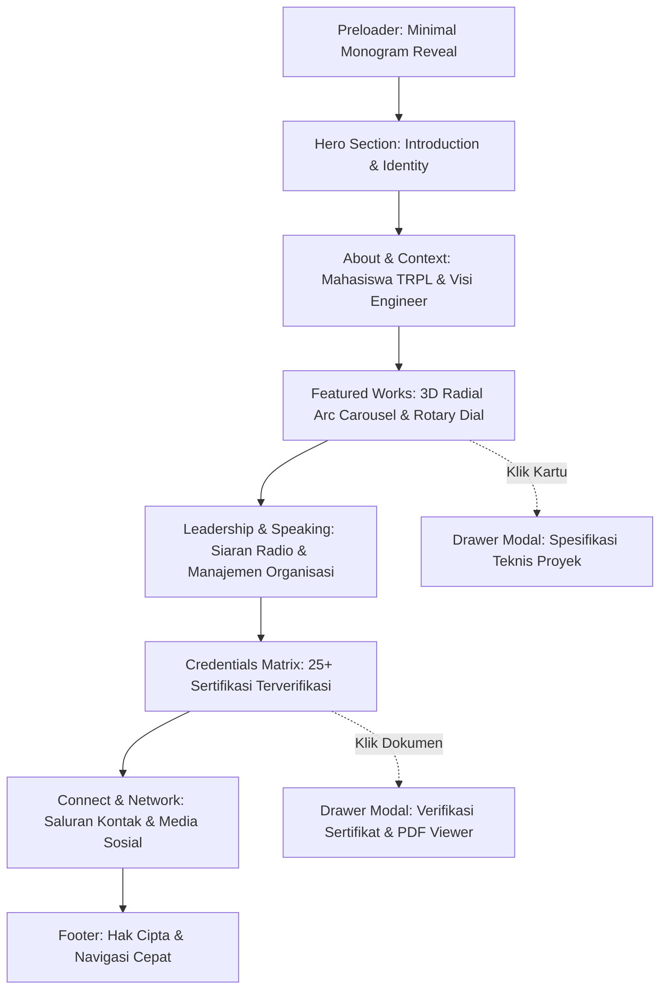

# INFORMATION ARCHITECTURE & SITEMAP
**Project:** DEVIS® Personal Portfolio  
**Stage:** 04 - Information Architecture  
**Kandidat:** Abu Devis Jalaluddin Rumi (`DEVIS®`)  
**Arsitektur:** Single-Page Editorial Architecture with Drawer Modals (Zero-Reload Flow)  

---

## 1. Pendekatan Arsitektur: Single-Page vs Multi-Page vs Hybrid

| Parameter Evaluasi | Single-Page Architecture | Multi-Page Architecture | Hybrid Editorial Drawer (Dipilih) |
|---|---|---|---|
| **Alur Cerita (Storytelling)** | Linear, mengalir alami tanpa jeda | Terpecah-pecah di rute terpisah | **Utuh, terarah, dan tidak membingungkan penilai** |
| **Kinerja & Skor Lighthouse** | Cepat, tapi rawan berat jika dom besar | Memuat ulang seluruh aset per halaman | **Maksimal (Skor ≥95); aset sekunder dimuat on-demand** |
| **Pengalaman 3D Orbital** | State rotasi tetap utuh selama scrolling | State 3D hilang setiap pindah halaman | **State rotasi 3D & rotary dial tetap sinkron** |
| **Kenyamanan Mobile** | Scroll vertikal intuitif dengan jempol | Banyak klik menu burger yang melelahkan | **Scroll vertikal lancar dengan drawer swipe sentuh** |

**Keputusan Arsitektur:** **Hybrid Editorial Drawer.** Seluruh perjalanan utama disajikan dalam satu halaman vertikal terpadu (*single-page seamless scroll*), sementara rincian mendalam (preview 25+ sertifikat, deskripsi teknis proyek) disajikan via drawer overlay interaktif tanpa memutus alur pandang pengguna.

---

## 2. Diagram Sitemap & Alur Halaman (Mermaid)



---

## 3. Hierarki Navigasi & Struktur Section

```text
DEVIS® Personal Portfolio (Single Page + Interactive Drawer)
├── 00. Global Header / Navbar (Sticky Minimalist Glass)
│   ├── Brand Wordmark: DEVIS® [TRPL-05]
│   ├── Quick Links: [01 Work] [02 About] [03 Leadership] [04 Credentials] [05 Contact]
│   └── Accent Interactive: Active Section Pill & Dial Progress Indicator
│
├── 01. Preloader (Micro-Sequence)
│   └── Monogram DEVIS® typography reveal -> Scale out to viewport
│
├── 02. Hero Section (The Technical Identity)
│   ├── Headline: "SOFTWARE ENGINEER / TECH ENTREPRENEUR"
│   ├── Sub-headline: Mahasiswa Teknologi Rekayasa Perangkat Lunak - Politeknik IDN
│   ├── Visual Element: Hero Portrait Sony Alpha (Monochrome Duotone + Depth Parallax)
│   └── Micro Metric: "ANGKATAN 05 • KELAS BOGOR • SEMESTER 01"
│
├── 03. About Section (Engineering Mindset & Narrative)
│   ├── Narasi Personal: Filosofi rekayasa perangkat lunak modern
│   ├── Fokus Bidang: Fullstack Development, API Architecture, Cloud Native
│   └── Triad Karakter: Technical Competence, Articulate Communication, Organizational Leadership
│
├── 04. Selected Works Section (3D Orbital Showcase)
│   ├── Section Header: [01 / SELECTED ENGINEERING WORKS]
│   ├── 3D Radial Arc Carousel (4 Kartu Melengkung):
│   │   ├── Card 01: DEVIS® 3D Portfolio (Creative Web & 3D CSS)
│   │   ├── Card 02: CapyQuest (Bun + Hono + React 19 RPG Habit)
│   │   ├── Card 03: BASOKU (Laravel + Livewire + MySQL ERD System)
│   │   └── Card 04: Setoran Companion (Lovable Cloud Tahfidz System)
│   ├── Bottom Rotary Dial Controller (Sinkronisasi Dua Arah)
│   └── Interactivity: Click to open Project Detail Drawer
│
├── 05. Leadership & Speaking Section (Human Dimension)
│   ├── Section Header: [02 / LEADERSHIP & PUBLIC SPEAKING]
│   ├── Story 01: Acara Siaran Radio "Santri Mengudara" (MC & Broadcaster)
│   ├── Story 02: Organisasi Santri/OSIS (Sekretaris & Bendahara Umum)
│   ├── Story 03: Bazaar Amal Manaahel (Ketua Panitia Pelaksana)
│   └── Story 04: Orasi Publik & Finalis Lomba Pidato Pekan Ukhuwwah
│
├── 06. Credentials & Mastery Section (Proof of Excellence)
│   ├── Section Header: [03 / VERIFIED CERTIFICATIONS & HONORS]
│   ├── Filter Kategori: [All] [Software Engineering] [AI & Systems] [Foundations & Character]
│   ├── Interactive Grid: 25+ Sertifikat (SantriKoding, Bisa.AI, Linux Foundation, Microsoft, FreeCodeCamp)
│   └── Action: Click to view PDF Certificate Modal Drawer
│
├── 07. Connect Section (Call to Collaboration)
│   ├── Section Header: [04 / INITIATE CONTACT]
│   ├── Primary CTA: Email Direct (`abudevis5@gmail.com`)
│   ├── Social Links: GitHub (`DevisRoomi`), LinkedIn (`Abu Devis Jalaluddin Rumi`), Instagram (`@adevss_`)
│   └── Quick Copy: One-click email copy button with visual feedback
│
└── 08. Footer
    ├── Colophon: Built with Bun, React, Vite, Tailwind & GSAP
    ├── Location Stamp: Bogor / Lumajang, Indonesia
    └── Back to Top Anchor: Smooth inertia return to hero
```
