# DEVELOPMENT TASK BREAKDOWN & IMPLEMENTATION BLUEPRINT
**Project:** DEVIS® Personal Portfolio  
**Stage:** 08 - Development Planning  
**Role:** Technical Project Manager & Senior Software Engineer  
**Kandidat:** Abu Devis Jalaluddin Rumi (`DEVIS®`)  
**Status:** Approved Architecture Implementation Blueprint (Zero Code / Planning Only)  

---

## 1. Project Overview

DEVIS® Personal Portfolio adalah aplikasi web statis single-page berbasis React 19, TypeScript, Bun, Tailwind CSS v3, Native CSS 3D Transforms, dan GSAP Core. Seluruh perencanaan mengacu mutlak pada:
- Identitas & Visi: `PROJECT_BRIEF.md`
- Data Personal & Proyek Nyata: `PERSONAL_CONTENT.md`
- Inventaris Aset Fisik & Resolusi: `ASSET_INVENTORY.md`
- Desain & Benchmark Majalah: `DESIGN_REFERENCES.md`
- Struktur Rute & Sitemap 7 Babak: `SITEMAP.md`
- Narasi Storytelling 5 Babak: `CONTENT_STRUCTURE.md`
- Sistem Token Charcoal `#121316` & Crimson `#e63946`: `DESIGN_SYSTEM.md`
- Matematika 3D Orbital & QA Matrix: `MOTION_SPEC.md`
- Arsitektur Teknis & Target Core Web Vitals: `TECHNICAL_ARCHITECTURE.md`
- Aturan Multi-Agent AI: `AGENTS.md`

---

## 2. Implementation Strategy

1. **Content & Structure First:** Struktur HTML semantik dan data bilingual statis dibangun sebelum efek visual.
2. **Layered Isolation:** Komponen visual 2D (layout editorial grid) distabilkan 100% sebelum menerapkan layer 3D orbital.
3. **Additive Enhancement:** Animasi GSAP dan kalkulasi CSS 3D diperlakukan sebagai enhancement, bukan pondasi struktural.
4. **Zero Runtime Assumption:** Tidak ada dependensi yang diinstal atau kode yang dibuat pada tahap ini.

---

## 3. Development Phases & Task Summary

| Phase | Nama Fase | Fokus Pekerjaan | Jumlah Task |
|---|---|---|---|
| **Phase 0** | Project Foundation | Scaffolding Vite + Bun, Tailwind v3, TS strict, lint, git hygiene | 5 Task |
| **Phase 1** | Core Foundation | Token CSS, typography WOFF2, asset staging, LanguageContext, MainLayout | 5 Task |
| **Phase 2** | Static Content Sections | 7 Babak Section semantik 100% data riil `PERSONAL_CONTENT.md` | 7 Task |
| **Phase 3** | Interactive Components | Language switcher, Project drawer, Certificate modal, Grid toggle, Quick copy | 6 Task |
| **Phase 4** | Motion & 3D Engine | Preloader event-driven, CSS 3D orbital math, Rotary dial, Scroll progress | 6 Task |
| **Phase 5** | Responsive & Accessibility | Keyboard tab navigation, reduced motion, touch gestures, pointer detection | 5 Task |
| **Phase 6** | Quality Assurance | Build audit, TS check, Lighthouse CWV, cross-browser Safari/Chrome, 4x CPU throttle | 5 Task |
| **Phase 7** | Documentation & Deploy | GitHub Pages actions, README.md, deployment verification | 4 Task |
| **TOTAL** | **8 Fase Terencana** | **Implementasi Bertahap Terukur** | **43 Task** |

---

## 4. Detailed Task Breakdown

### Phase 0: Project Foundation (Setup & Lingkungan)

#### `TASK-001`: Inisialisasi Vite + React 19 + TypeScript via Bun
- **Deskripsi:** Menjalankan scaffolding template `bun create vite devis-portfolio --template react-ts`.
- **Target File/Folder:** `package.json`, `tsconfig.json`, `vite.config.ts`, `src/`.
- **Prasyarat:** Persetujuan Tahap 08 oleh pengguna.
- **Prioritas / Kompleksitas:** Critical / Small.
- **Acceptance Criteria:** `bun install` selesai tanpa error; `bun run build` menghasilkan bundle TypeScript valid.
- **Risiko / Catatan:** Pastikan TypeScript versi strict (`noImplicitAny: true`).

#### `TASK-002`: Instalasi Dependensi Terbatas & Terkurasi
- **Deskripsi:** Memasang dependensi produksi (`gsap`, `lucide-react`) dan dependensi dev (`tailwindcss`, `postcss`, `autoprefixer`, `@types/*`).
- **Target File/Folder:** `package.json`, `bun.lockb`.
- **Prasyarat:** `TASK-001`.
- **Prioritas / Kompleksitas:** Critical / Small.
- **Acceptance Criteria:** Hanya library yang disetujui di `TECHNICAL_ARCHITECTURE.md` yang terpasang; zero unnecessary packages.
- **Risiko / Catatan:** Kunci versi `tailwindcss` pada `^3.4.17` untuk stabilitas utility class.

#### `TASK-003`: Konfigurasi Tailwind CSS v3 & PostCSS
- **Deskripsi:** Inisialisasi `tailwind.config.ts` dan `postcss.config.js` dengan token Charcoal `#121316`, surface `#1a1b20`, elevated `#22242b`, crimson `#e63946`.
- **Target File/Folder:** `tailwind.config.ts`, `postcss.config.js`, `src/styles/globals.css`.
- **Prasyarat:** `TASK-002`.
- **Prioritas / Kompleksitas:** Critical / Small.
- **Acceptance Criteria:** Utility class kustom (`bg-canvas-bg`, `text-crimson`, `font-display`) terkompilasi dengan benar.
- **Risiko / Catatan:** Hindari plugin pihak ketiga; gunakan native CSS variable binding.

#### `TASK-004`: Setup Struktur Direktori Standar Arsitektur
- **Deskripsi:** Membentuk pohon folder sesuai blueprint `AGENTS.md`.
- **Target File/Folder:** `src/components/`, `src/sections/`, `src/content/`, `src/context/`, `src/hooks/`, `src/animations/`, `src/layouts/`, `src/styles/`, `public/assets/`.
- **Prasyarat:** `TASK-001`.
- **Prioritas / Kompleksitas:** High / Small.
- **Acceptance Criteria:** Seluruh folder terbentuk; tidak ada file redundant.
- **Risiko / Catatan:** Patuhi batas tanggung jawab masing-masing folder.

#### `TASK-005`: Setup Git Hygiene & Base Path Vite
- **Deskripsi:** Mengonfigurasi `.gitignore` komprehensif dan `vite.config.ts` dengan dynamic base path untuk GitHub Pages.
- **Target File/Folder:** `.gitignore`, `vite.config.ts`.
- **Prasyarat:** `TASK-001`.
- **Prioritas / Kompleksitas:** High / Small.
- **Acceptance Criteria:** `.gitignore` mengecualikan `node_modules`, `dist`, `.env*`; `vite.config.ts` memiliki `base: process.env.GITHUB_PAGES === 'true' ? ... : '/'`.
- **Risiko / Catatan:** Belum membuat git repo remote hingga NIM diberikan.

---

### Phase 1: Core Foundation (Design System & Shell)

#### `TASK-006`: Implementasi CSS Tokens & Global Reset
- **Deskripsi:** Mengisi `src/styles/globals.css` dengan CSS variables palette Charcoal, hairline border, dan reset scrollbar.
- **Target File/Folder:** `src/styles/globals.css`.
- **Prasyarat:** `TASK-003`.
- **Prioritas / Kompleksitas:** Critical / Small.
- **Acceptance Criteria:** Background `#121316` aktif; text default `#f1f1f4`; font antialiased.
- **Risiko / Catatan:** Zero layout shift reset pada box-sizing.

#### `TASK-007`: Manajemen Web Font Lokal (WOFF2) & Preload
- **Deskripsi:** Meletakkan file font `Syne-Bold.woff2`, `PlusJakartaSans-Regular.woff2`, dan `JetBrainsMono.woff2` di `public/assets/fonts/` serta mendefinisikan `@font-face` dengan `font-display: swap`.
- **Target File/Folder:** `public/assets/fonts/`, `src/styles/globals.css`, `index.html`.
- **Prasyarat:** `TASK-004`.
- **Prioritas / Kompleksitas:** High / Small.
- **Acceptance Criteria:** Font termuat lokal tanpa request eksternal ke Google Fonts (Zero Third-Party FOIT).
- **Risiko / Catatan:** Pastikan path absolut `/assets/fonts/` kompatibel dengan base path deployment.

#### `TASK-008`: Staging Aset Gambar Terverifikasi
- **Deskripsi:** Menempatkan dan mengoptimasi foto portrait Sony Alpha, thumbnail 4 proyek, dan ikon di `public/assets/images/` dan `public/assets/projects/` dalam format WebP.
- **Target File/Folder:** `public/assets/images/`, `public/assets/projects/`.
- **Prasyarat:** `TASK-004`.
- **Prioritas / Kompleksitas:** High / Medium.
- **Acceptance Criteria:** Seluruh aset riil dari `docs/ASSET_INVENTORY.md` tersedia dan terkompresi (<100KB per gambar).
- **Risiko / Catatan:** Pertahankan rasio aspek 16:10 pada thumbnail proyek.

#### `TASK-009`: Language Context & Type-Safe Dictionary Interface
- **Deskripsi:** Membuat tipe TypeScript `PortfolioContent` di `src/content/types.ts` dan provider `LanguageContext.tsx` untuk toggle `id` / `en` dengan persistensi `localStorage`.
- **Target File/Folder:** `src/content/types.ts`, `src/context/LanguageContext.tsx`.
- **Prasyarat:** `TASK-004`.
- **Prioritas / Kompleksitas:** Critical / Medium.
- **Acceptance Criteria:** Toggle state bahasa reaktif; fallback default `id` tersimpan di `localStorage`.
- **Risiko / Catatan:** Pastikan struktur dictionary `id.ts` dan `en.ts` identik secara tipe (`100% type coverage`).

#### `TASK-010`: Layout Shell (MainLayout, Navbar & Footer)
- **Deskripsi:** Membangun `MainLayout.tsx`, sticky glass `FloatingNavbar.tsx`, dan `Footer.tsx` colophon dengan smooth back-to-top.
- **Target File/Folder:** `src/layouts/MainLayout.tsx`, `src/components/navigation/FloatingNavbar.tsx`, `src/components/ui/Footer.tsx`.
- **Prasyarat:** `TASK-006`, `TASK-009`.
- **Prioritas / Kompleksitas:** High / Medium.
- **Acceptance Criteria:** Navbar sticky melayang dengan backdrop-blur; link anchor (`#about`, `#works`, dll) mengarah ke section target; footer menampilkan lokasi Bogor/Lumajang.
- **Risiko / Catatan:** Navbar tidak boleh menutupi elemen saat di-scroll (padding offset terukur).

---

### Phase 2: Static Content Sections (Data Riil & Semantik)

#### `TASK-011`: Dictionaries Bilingual Data Riil (`id.ts` & `en.ts`)
- **Deskripsi:** Memetakan seluruh data profil, 4 proyek, kepemimpinan, dan 25+ sertifikat dari `PERSONAL_CONTENT.md` ke dalam format TypeScript terstruktur.
- **Target File/Folder:** `src/content/id.ts`, `src/content/en.ts`.
- **Prasyarat:** `TASK-009`.
- **Prioritas / Kompleksitas:** Critical / Medium.
- **Acceptance Criteria:** 100% data riil tanpa teks dummy; validasi compiler TS lolos tanpa error tipe.
- **Risiko / Catatan:** Sinkronkan istilah teknis bahasa Inggris agar panjang kalimat proporsional.

#### `TASK-012`: Implementasi Semantic Hero Section
- **Deskripsi:** Membangun `02_HeroSection.tsx` menampilkan judul tipografi Syne, badge status TRPL Angkatan 5 berkedip crimson, dan foto portrait Sony Alpha.
- **Target File/Folder:** `src/sections/02_HeroSection.tsx`.
- **Prasyarat:** `TASK-010`, `TASK-011`.
- **Prioritas / Kompleksitas:** High / Medium.
- **Acceptance Criteria:** Teks terbaca jelas; layout grid 2 kolom desktop beralih 1 kolom mobile; hero image di-preload.
- **Risiko / Catatan:** Zero text distortion; teks langsung tajam sejak first paint.

#### `TASK-013`: Implementasi Semantic About Section (Triad Karakter)
- **Deskripsi:** Membangun `03_AboutSection.tsx` memaparkan filosofi rekayasa dan Triad Karakter (Technical Competence, Articulate Communication, Organizational Leadership).
- **Target File/Folder:** `src/sections/03_AboutSection.tsx`.
- **Prasyarat:** `TASK-011`.
- **Prioritas / Kompleksitas:** Medium / Small.
- **Acceptance Criteria:** Tiga pilar karakter tampil dengan kartu beraksen subtle border; tipografi editorial proporsional.
- **Risiko / Catatan:** Keterbacaan teks body memenuhi kontras WCAG AAA.

#### `TASK-014`: Implementasi Base Works Section (Editorial Grid Layout)
- **Deskripsi:** Membangun `04_WorksSection.tsx` yang merender 4 proyek unggulan dalam format Grid 2 Kolom Asimetris sebagai baseline statis.
- **Target File/Folder:** `src/sections/04_WorksSection.tsx`, `src/components/cards/ProjectCard.tsx`.
- **Prasyarat:** `TASK-011`.
- **Prioritas / Kompleksitas:** Critical / Medium.
- **Acceptance Criteria:** Keempat proyek (DEVIS Portfolio, CapyQuest, BASOKU, Setoran Companion) tampil lengkap dengan tag stack dan deskripsi.
- **Risiko / Catatan:** Pastikan kontainer siap menerima mode toggle orbital 3D di Phase 4.

#### `TASK-015`: Implementasi Leadership & Speaking Section
- **Deskripsi:** Membangun `05_LeadershipSection.tsx` menampilkan rekam jejak MC Santri Mengudara, Bazaar Amal Manaahel, dan Sekretaris/Bendahara OSIS.
- **Target File/Folder:** `src/sections/05_LeadershipSection.tsx`, `src/components/cards/LeadershipCard.tsx`.
- **Prasyarat:** `TASK-011`.
- **Prioritas / Kompleksitas:** High / Medium.
- **Acceptance Criteria:** Dokumentasi foto terpasang; metadata event, tanggal, dan peran tampil presisi.
- **Risiko / Catatan:** Foto monokromatik default bertransisi full-color saat hover.

#### `TASK-016`: Implementasi Credentials Section (Grid 25+ Sertifikat)
- **Deskripsi:** Membangun `06_CredentialsSection.tsx` menampilkan kartu sertifikat terkurasi dengan filter kategori (`All`, `Software Engineering`, `AI & Systems`, `Foundations`).
- **Target File/Folder:** `src/sections/06_CredentialsSection.tsx`, `src/components/cards/CertificateCard.tsx`.
- **Prasyarat:** `TASK-011`.
- **Prioritas / Kompleksitas:** High / Medium.
- **Acceptance Criteria:** Grid sertifikat merender seluruh item terverifikasi; badge penerbit (SantriKoding, Bisa.AI, Linux, dll) jelas.
- **Risiko / Catatan:** Lazy-loading thumbnail kartu untuk menjaga konsumsi RAM peramban.

#### `TASK-017`: Implementasi Contact Section (Saluran Kolaborasi)
- **Deskripsi:** Membangun `07_ContactSection.tsx` dengan CTA email utama `abudevis5@gmail.com` dan direct links ke GitHub, LinkedIn, dan Instagram.
- **Target File/Folder:** `src/sections/07_ContactSection.tsx`.
- **Prasyarat:** `TASK-011`.
- **Prioritas / Kompleksitas:** High / Small.
- **Acceptance Criteria:** Tautan eksternal menggunakan `rel="noopener noreferrer"`; alamat email tampil eksplisit dan dapat disalin.
- **Risiko / Catatan:** Tombol interaksi cepat disiapkan untuk feedback taktil di Phase 3.

---

### Phase 3: Interactive Components (State & Modals)

#### `TASK-018`: Language Switcher Interaktif
- **Deskripsi:** Komponen toggle bahasa ID/EN pada navbar dengan transisi visual mulus dan aria-label yang tepat.
- **Target File/Folder:** `src/components/navigation/LanguageSwitcher.tsx`.
- **Prasyarat:** `TASK-009`, `TASK-010`.
- **Prioritas / Kompleksitas:** High / Small.
- **Acceptance Criteria:** Mengklik tombol mengubah seluruh teks UI seketika; state tersimpan di `localStorage`.
- **Risiko / Catatan:** Uji stabilitas layout agar pergantian bahasa tidak menyebabkan lonjakan elemen (*layout shift*).

#### `TASK-019`: Project Detail Drawer (Sliding Overlay)
- **Deskripsi:** Modal drawer sisi kanan (`translateX`) untuk menampilkan studi kasus mendalam proyek saat kartu diklik.
- **Target File/Folder:** `src/components/modals/ProjectDrawer.tsx`.
- **Prasyarat:** `TASK-014`.
- **Prioritas / Kompleksitas:** High / Medium.
- **Acceptance Criteria:** Drawer meluncur mulus; backdrop blur aktif; scroll halaman utama terkunci saat drawer terbuka; tombol ESC dan tombol silang menutup drawer.
- **Risiko / Catatan:** Manajemen fokus keyboard (`focus-trap`) agar pengguna keyboard tidak tersesat.

#### `TASK-020`: Certificate PDF Preview Modal
- **Deskripsi:** Modal pratinjau lembaran dokumen sertifikat PDF/gambar beresolusi tinggi di tengah layar.
- **Target File/Folder:** `src/components/modals/CertificateModal.tsx`.
- **Prasyarat:** `TASK-016`.
- **Prioritas / Kompleksitas:** Medium / Small.
- **Acceptance Criteria:** Modal muncul di tengah viewport; tombol ESC menutup modal; link unduh atau buka tab baru tersedia.
- **Risiko / Catatan:** Fallback gambar jika PDF viewer native peramban tidak didukung.

#### `TASK-021`: Filter Kategori Sertifikat Reaktif
- **Deskripsi:** Logika state filtering untuk menampilkan sertifikat berdasarkan kategori terpilih dengan animasi fade halus.
- **Target File/Folder:** `src/sections/06_CredentialsSection.tsx`.
- **Prasyarat:** `TASK-016`.
- **Prioritas / Kompleksitas:** Medium / Small.
- **Acceptance Criteria:** Mengklik tab filter menyaring daftar sertifikat secara instan tanpa glitch tata letak.
- **Risiko / Catatan:** Jumlah item hasil filter selalu akurat sesuai kategori.

#### `TASK-022`: Tombol Toggle [ORBITAL 3D / EDITORIAL GRID]
- **Deskripsi:** Tombol toggle arsitektural pada sub-header Works Section untuk beralih antara mode 3D dan Grid.
- **Target File/Folder:** `src/sections/04_WorksSection.tsx`.
- **Prasyarat:** `TASK-014`.
- **Prioritas / Kompleksitas:** Critical / Small.
- **Acceptance Criteria:** Toggle mengubah state `viewMode`; transisi crossfade 250ms berjalan mulus; preferensi tersimpan di `sessionStorage`.
- **Risiko / Catatan:** Pastikan kedua tampilan dapat diakses bergantian tanpa error state React.

#### `TASK-023`: Quick Copy Email Feedback Interaction
- **Deskripsi:** Tombol salin email satu klik dengan animasi rotasi ikon, feedback centang crimson, dan toast teks konfirmasi.
- **Target File/Folder:** `src/components/ui/CopyEmailButton.tsx`.
- **Prasyarat:** `TASK-017`.
- **Prioritas / Kompleksitas:** Medium / Small.
- **Acceptance Criteria:** Mengklik tombol menyalin teks ke clipboard; ikon berubah centang selama 2 detik; fallback jika clipboard API diblokir.
- **Risiko / Catatan:** Gunakan `navigator.clipboard.writeText` dengan try-catch fallback.

---

### Phase 4: Motion & 3D Engine (Physics & Parametric Math)

#### `TASK-024`: Implementasi Preloader Kritis (Event-Driven + Hard Timeout)
- **Deskripsi:** Preloader memantau `document.fonts.ready` + `heroImage.decode()`, batas waktu paksa 1400ms, dan tombol `[ESC / Skip]`.
- **Target File/Folder:** `src/sections/01_Preloader.tsx`.
- **Prasyarat:** `TASK-007`, `TASK-008`.
- **Prioritas / Kompleksitas:** Critical / Medium.
- **Acceptance Criteria:** Tirai preloader meluncur ke atas saat font & foto siap atau tepat pada 1400ms; tombol skip dapat diakses via keyboard/touch.
- **Risiko / Catatan:** Jangan menahan penilai jika jaringan lambat; bypass preloader bekerja deterministik.

#### `TASK-025`: Helper Matematika 3D Parametrik (`orbitalMath.ts`)
- **Deskripsi:** Menulis unit kalkulasi matematis sudut busur ($\Delta	heta = \Omega / (N - 1)$), radius dinamis $R$, skala kartu, dan inersia snapping.
- **Target File/Folder:** `src/animations/orbitalMath.ts`.
- **Prasyarat:** `TASK-004`.
- **Prioritas / Kompleksitas:** Critical / Medium.
- **Acceptance Criteria:** Lolos pengujian untuk $N = 1, 2, 3, 4, 6$; penanganan pembagian nol pada $N = 1$; auto-fallback jika $N < 3$ atau layar <900px.
- **Risiko / Catatan:** Pure function tanpa efek samping DOM agar mudah diuji via unit test/assert.

#### `TASK-026`: 3D Radial Arc Carousel Komponen
- **Deskripsi:** Membangun panggung CSS 3D (`perspective: 1000px`, `transform-style: preserve-3d`, `overflow: visible`) dan menggerakkan kartu via transform `rotateY` + `translateZ`.
- **Target File/Folder:** `src/components/3d/OrbitalCarousel3D.tsx`, `src/styles/3d-orbital.css`.
- **Prasyarat:** `TASK-022`, `TASK-025`.
- **Prioritas / Kompleksitas:** Critical / Large.
- **Acceptance Criteria:** 4 kartu tersusun dalam busur 140°; drag mouse dan swipe sentuh memutar busur dengan peluruhan inersia 60 FPS; kartu aktif berada di tengah.
- **Risiko / Catatan:** Dilarang menggunakan `contain: paint`; suntikkan `will-change: transform` hanya saat drag berlangsung.

#### `TASK-027`: Two-Way Bottom Rotary Dial Controller
- **Deskripsi:** Busur dial bawah dengan jarum Electric Crimson yang bergerak sinkron dua arah terhadap posisi kartu carousel.
- **Target File/Folder:** `src/components/3d/RotaryDial.tsx`, `src/components/3d/DialNeedle.tsx`.
- **Prasyarat:** `TASK-026`.
- **Prioritas / Kompleksitas:** High / Medium.
- **Acceptance Criteria:** Memutar dial menggerakkan kartu; menggeser kartu memutar jarum dial (-60° s.d. +60°); visual ticks memanjang saat dilintasi.
- **Risiko / Catatan:** Hindari cyclic event update antara dial dan carousel dengan state locking.

#### `TASK-028`: Scroll Progress Indicator & Back to Top Native
- **Deskripsi:** Hairline bar merah crimson di batas bawah navbar meluas 0–100% mengikuti scroll dokumen, dan tombol Back to Top dengan native smooth scrolling.
- **Target File/Folder:** `src/components/navigation/ScrollProgress.tsx`, `src/components/ui/BackToTop.tsx`.
- **Prasyarat:** `TASK-010`.
- **Prioritas / Kompleksitas:** Medium / Small.
- **Acceptance Criteria:** Progress bar responsif terhadap scroll; tombol Back to Top meluncur mulus ke koordinat Y: 0 dengan kurva arsitektural.
- **Risiko / Catatan:** Throttling event listener scroll via `requestAnimationFrame` untuk efisiensi CPU.

#### `TASK-029`: Kinetic Typography & Section Reveal
- **Deskripsi:** Marquee teks teknis berjalan kontinu via CSS GPU transform murni dan class reveal masuk standar `.reveal-in`.
- **Target File/Folder:** `src/components/ui/KineticTicker.tsx`, `src/hooks/useSectionReveal.ts`.
- **Prasyarat:** `TASK-006`.
- **Prioritas / Kompleksitas:** Medium / Small.
- **Acceptance Criteria:** Marquee berjalan mulus tanpa getaran; elemen heading muncul saat masuk viewport.
- **Risiko / Catatan:** Zero text distortion; tidak ada teks yang kabur atau terpotong saat reveal.

---

### Phase 5: Responsive & Accessibility (Inklusivitas & Guardrails)

#### `TASK-030`: Deteksi Kemampuan Pointer & Media Query Guard
- **Deskripsi:** Hook `usePointerType.ts` untuk mendeteksi `(hover: hover) and (pointer: fine)` guna mengisolasi efek magnetik dan custom cursor.
- **Target File/Folder:** `src/hooks/usePointerType.ts`, `src/components/ui/MagneticButton.tsx`.
- **Prasyarat:** `TASK-004`.
- **Prioritas / Kompleksitas:** High / Small.
- **Acceptance Criteria:** Efek magnetik aktif pada desktop dengan mouse; otomatis mati total pada ponsel dan layar sentuh.
- **Risiko / Catatan:** Hindari listener mousemove pada perangkat touch untuk menghemat baterai.

#### `TASK-031`: Kepatuhan Penuh `prefers-reduced-motion`
- **Deskripsi:** Hook `useReducedMotion.ts` dan styling CSS fallback untuk mematikan rotasi 3D dan transisi panjang jika fitur hemat gerak aktif di OS penilai.
- **Target File/Folder:** `src/hooks/useReducedMotion.ts`, `src/styles/globals.css`.
- **Prasyarat:** `TASK-026`.
- **Prioritas / Kompleksitas:** Critical / Small.
- **Acceptance Criteria:** Ketika reduced motion aktif, carousel 3D langsung beralih ke daftar statis; waktu transisi menjadi 0.01ms.
- **Risiko / Catatan:** Seluruh konten tetap 100% terbaca dan dapat diakses.

#### `TASK-032`: Navigasi Keyboard Penuh (Focus Management)
- **Deskripsi:** Konfigurasi tab order, outline fokus crimson `2px solid #e63946`, dan tombol navigasi panah (`ArrowLeft` / `ArrowRight`) untuk memutar carousel.
- **Target File/Folder:** `src/components/3d/OrbitalCarousel3D.tsx`, `src/layouts/MainLayout.tsx`.
- **Prasyarat:** `TASK-026`.
- **Prioritas / Kompleksitas:** Critical / Medium.
- **Acceptance Criteria:** Seluruh situs dapat dioperasikan penuh hanya menggunakan keyboard; tidak ada perangkap fokus (*focus trap*) yang menjebak pengguna.
- **Risiko / Catatan:** Komponen drawer mengembalikan fokus ke trigger button saat ditutup.

#### `TASK-033`: Adaptasi Layout Mobile & Touch Swipe Stack
- **Deskripsi:** Penyesuaian layout seluruh babak untuk layar ponsel (<768px) dan tablet; carousel 3D otomatis beralih ke mode Editorial Grid / Swipe Stack.
- **Target File/Folder:** `src/sections/*.tsx`.
- **Prasyarat:** `TASK-014`, `TASK-026`.
- **Prioritas / Kompleksitas:** High / Medium.
- **Acceptance Criteria:** Tampilan rapi pada viewport 360px s.d. 768px; zero horizontal unwanted scrollbar.
- **Risiko / Catatan:** Target sentuh tombol minimal 48px × 48px.

#### `TASK-034`: Implementasi Semantic `<noscript>` Fallback
- **Deskripsi:** Memasukkan struktur HTML semantik murni di dalam tag `<noscript>` pada `index.html` sesuai spesifikasi `TECHNICAL_ARCHITECTURE.md`.
- **Target File/Folder:** `index.html`.
- **Prasyarat:** `TASK-001`, `TASK-011`.
- **Prioritas / Kompleksitas:** Critical / Small.
- **Acceptance Criteria:** Jika JS dimatikan di browser, ringkasan profil, 4 proyek, kepemimpinan, dan kontak langsung tampil dalam format majalah editorial.
- **Risiko / Catatan:** Uji secara nyata di Chrome dengan menonaktifkan JavaScript.

---

### Phase 6: Quality Assurance & Performance Tuning

#### `TASK-035`: TypeScript Strict Compilation Audit
- **Deskripsi:** Menjalankan type-check menyeluruh menggunakan `bun run tsc --noEmit`.
- **Target File/Folder:** Seluruh codebase `src/`.
- **Prasyarat:** Selesai Phase 0 s.d. Phase 5.
- **Prioritas / Kompleksitas:** Critical / Small.
- **Acceptance Criteria:** Exit code 0; zero implicit any; zero typing warning.
- **Risiko / Catatan:** Selesaikan setiap error tipe sebelum melanjutkan ke pengujian bundle.

#### `TASK-036`: Production Build & Bundle Size Optimization
- **Deskripsi:** Menjalankan `bun run build` dan memverifikasi chunk splitting (`react_core`, `animation_engine`, `ui_icons`).
- **Target File/Folder:** `dist/`, `vite.config.ts`.
- **Prasyarat:** `TASK-035`.
- **Prioritas / Kompleksitas:** Critical / Small.
- **Acceptance Criteria:** Total bundle gzipped < 150KB; build selesai tanpa warning circular dependency.
- **Risiko / Catatan:** Pastikan asset hash terkonfigurasi dengan benar untuk cache busting.

#### `TASK-037`: VRAM & 60 FPS Profiling (Chrome DevTools Rendering)
- **Deskripsi:** Menguji frame rate rotasi 3D carousel, memeriksa layer borders, dan paint flashing untuk memastikan tidak ada layout thrashing.
- **Target File/Folder:** `src/components/3d/OrbitalCarousel3D.tsx`.
- **Prasyarat:** `TASK-036`.
- **Prioritas / Kompleksitas:** High / Medium.
- **Acceptance Criteria:** FPS stabil ≥55 FPS saat drag aktif; hanya kontainer 3D yang berpendar hijau pada Paint Flashing.
- **Risiko / Catatan:** Jalankan simulasi *4x CPU Slowdown* untuk menjamin performa di prosesor laptop hemat daya.

#### `TASK-038`: Audit Core Web Vitals & Lighthouse Lokal
- **Deskripsi:** Menjalankan audit performa menggunakan Google Lighthouse.
- **Target File/Folder:** `dist/`.
- **Prasyarat:** `TASK-036`.
- **Prioritas / Kompleksitas:** Critical / Medium.
- **Acceptance Criteria:** Kepatuhan Ambang Resmi Google (LCP ≤ 2.5s, INP ≤ 200ms, CLS ≤ 0.10) dan Target Optimasi Lighthouse ≥ 90.
- **Risiko / Catatan:** Evaluasi blocking resources dan optimasi critical rendering path.

#### `TASK-039`: Cross-Browser & Mobile Touch Verification
- **Deskripsi:** Memverifikasi keselarasan visual pada Chrome, Edge, Firefox, dan Safari (termasuk Safari iOS `-webkit-transform-style: preserve-3d`).
- **Target File/Folder:** Seluruh aplikasi.
- **Prasyarat:** `TASK-036`.
- **Prioritas / Kompleksitas:** High / Medium.
- **Acceptance Criteria:** Tampilan konsisten; zero CSS tearing; gestur sentuh responsif.
- **Risiko / Catatan:** Waspadai perbedaan kalkulasi z-index 3D pada mesin WebKit.

---

### Phase 7: Documentation & Deployment Setup

#### `TASK-040`: Penyusunan Dokumen README.md Komprehensif
- **Deskripsi:** Menyusun `README.md` repositori yang menjelaskan arsitektur DEVIS®, stack teknologi, instruksi build lokal via Bun, dan link demo.
- **Target File/Folder:** `README.md`.
- **Prasyarat:** `TASK-036`.
- **Prioritas / Kompleksitas:** High / Small.
- **Acceptance Criteria:** README informatif, rapi, memuat badge teknologi dan tangkapan layar antarmuka.
- **Risiko / Catatan:** Pastikan informasi akademik TRPL Politeknik IDN tercantum dengan wibawa.

#### `TASK-041`: Konfigurasi Otomasi GitHub Actions Workflow
- **Deskripsi:** Membuat berkas `.github/workflows/deploy.yml` untuk build otomatis menggunakan Bun dan deployment ke GitHub Pages.
- **Target File/Folder:** `.github/workflows/deploy.yml`.
- **Prasyarat:** `TASK-005`.
- **Prioritas / Kompleksitas:** High / Small.
- **Acceptance Criteria:** Script workflow valid secara sintaksis YAML; aksi mencakup checkout, setup-bun, build, dan deploy-pages.
- **Risiko / Catatan:** Konfigurasi environment `GITHUB_PAGES: 'true'` terpasang pada step build.

#### `TASK-042`: Setup Konvensi Repository Git Lokal (Menunggu NIM)
- **Deskripsi:** Inisialisasi git lokal (`git init`), pembuatan branch `main`, dan commit awal setelah seluruh berkas siap dan NIM diberikan oleh pengguna.
- **Target File/Folder:** `.git/`.
- **Prasyarat:** Izin langsung pengguna dan pemberian NIM.
- **Prioritas / Kompleksitas:** Critical / Small.
- **Acceptance Criteria:** Repository bersih; pesan commit mengikuti standar Conventional Commits (`feat: initial project foundation`).
- **Risiko / Catatan:** Dilarang membuat repo remote atau melakukan push sebelum persetujuan eksplisit pengguna.

#### `TASK-043`: Verifikasi Live Deployment & Health Check
- **Deskripsi:** Memeriksa hasil deployment di GitHub Pages (atau Vercel alternatif) untuk memastikan aset WOFF2 dan WebP termuat dengan status HTTP 200.
- **Target File/Folder:** Live URL.
- **Prasyarat:** `TASK-041`, `TASK-042`.
- **Prioritas / Kompleksitas:** Critical / Small.
- **Acceptance Criteria:** Website dapat diakses publik; zero 404 pada routing sub-path; preloader dan 3D carousel berfungsi normal.
- **Risiko / Catatan:** Periksa base path URL gambar dan font agar tidak pecah di sub-path GitHub Pages.

---

## 5. Dependencies & Implementation Order

```mermaid
graph TD
    P0[Phase 0: Project Foundation] --> P1[Phase 1: Core Foundation]
    P1 --> P2[Phase 2: Static Content Sections]
    P2 --> P3[Phase 3: Interactive Components]
    P3 --> P4[Phase 4: Motion & 3D Engine]
    P4 --> P5[Phase 5: Responsive & Accessibility]
    P5 --> P6[Phase 6: Quality Assurance]
    P6 --> P7[Phase 7: Documentation & Deploy]

    subgraph CriticalGating [Gerbang Kritis]
        P0 -. "Wajib: TS Strict & Tailwind v3 Ready" .-> P1
        P2 -. "Wajib: Konten 100% Nyata & Stabil 2D" .-> P3
        P3 -. "Wajib: State & Toggle Grid Siap" .-> P4
        P5 -. "Wajib: 60 FPS & A11y Lolos" .-> P6
        P6 -. "Wajib: Build & CWV Lolos" .-> P7
    end
```

### Aturan Urutan Kerja:
1. **Dilarang memulai Phase 4 (Motion/3D) sebelum Phase 2 dan Phase 3 selesai.** Tampilan 2D statis wajib sempurna terlebih dahulu.
2. **Dilarang memasang optimasi sebelum ada kode yang dapat diukur.**
3. **Setiap task yang gagal uji (test failing) wajib diselesaikan sebelum beralih ke task berikutnya.**

---

## 6. Milestones & Approval Gates

| Milestone | Kriteria Kelulusan (Gate Conditions) | Tindakan Lanjutan |
|---|---|---|
| **M0: Environment Ready** | Vite + Bun + Tailwind v3 + TS terkonfigurasi, build lokal lolos. | Pengguna menyetujui fondasi kode. |
| **M1: Design Shell & i18n Active** | Token Charcoal `#121316` aktif, font WOFF2 termuat, toggle bahasa ID/EN berfungsi. | Lanjut ke pengisian babak konten. |
| **M2: Complete Static Content** | 7 Babak Section terisi 100% data riil dari `PERSONAL_CONTENT.md`. | Lanjut ke interaktivitas & modal. |
| **M3: Interactive UI & Grid Toggle** | Project Drawer, Certificate Modal, dan toggle Grid berfungsi tanpa error. | Lanjut ke integrasi engine 3D. |
| **M4: 3D Orbital & Motion Calibrated** | Preloader event-driven, carousel 3D 60 FPS, dan rotary dial sinkron dua arah. | Lanjut ke audit responsif & aksesibilitas. |
| **M5: Inklusif & Responsif 100%** | Keyboard tab outline crimson bekerja, reduced motion lolos, mobile touch mulus. | Lanjut ke audit performa final. |
| **M6: QA Audit & Core Web Vitals Pass** | LCP ≤ 2.5s, INP ≤ 200ms, CLS ≤ 0.10, Lighthouse ≥ 90, zero TS error. | Pengguna memberikan NIM untuk Git & deploy. |
| **M7: Live Production Release** | Live di GitHub Pages, zero broken link/assets, README lengkap. | Proyek DEVIS® Resmi Dirilis. |

---

## 7. Testing Strategy per Fase

| Fase | Metode Pengujian | Tool / Perintah | Syarat Lulus |
|---|---|---|---|
| **Phase 0 & 1** | Build & Type Check | `bun run build` && `bun run tsc` | Zero compilation error, bundle terbentuk di `dist/`. |
| **Phase 2** | Content Integrity Audit | Manual Review terhadap `PERSONAL_CONTENT.md` | 100% data cocok; zero nama/gelar/proyek dummy. |
| **Phase 3** | Modal & State Test | Click & Escape interaction test | Drawer dan modal membuka/menutup; scroll body terkunci rapi. |
| **Phase 4** | 60 FPS & Math Test | Chrome Rendering FPS Meter & Throttling | Frame rate ≥55 FPS saat drag; rumus matematis presisi untuk $N=4$. |
| **Phase 5** | Accessibility & Fallback | Keyboard only nav & Emulate reduced motion | Seluruh tombol terjangkau via Tab; 3D mati saat reduced motion. |
| **Phase 6** | Core Web Vitals Audit | Lighthouse CLI & WebPageTest | LCP ≤ 2.5s (Target ≤ 1.8s), INP ≤ 200ms, CLS ≤ 0.10. |
| **Phase 7** | Deployment Health Check | HTTP Status & Console Check | HTTP 200 pada seluruh aset; zero console error di production. |

---

## 8. AI Collaboration Workflow (Multi-Agent Protocol)

Sesuai panduan `AGENTS.md`:
1. **Hermes (Lead Coordinator):** Mengawasi kepatuhan terhadap task ID aktif, menjalankan build/audit di terminal, dan memvalidasi penyelesaian task.
2. **Antigravity (UI Developer):** Mengimplementasikan komponen di `src/components/`, styling Tailwind, dan penyempurnaan interaktif.
3. **GPT (Code & Math Reviewer):** Memeriksa kalkulasi sudut 3D di `orbitalMath.ts`, audit tipe data TypeScript, dan mitigasi bug build.
4. **Gemini (Visual & Contrast Auditor):** Memverifikasi rasio kontras warna charcoal/crimson dan estetika majalah editorial.
5. **Kiro (Acceptance Criteria Validator):** Memastikan tidak ada data riil yang diubah atau dikurangi dari dokumen sumber.

**Aturan Kerja Mutlak:**
- **Satu file hanya boleh diubah oleh 1 agent dalam satu waktu.**
- Setiap task selesai harus disertai laporan verifikasi nyata.
- Dilarang melanjutkan ke milestone berikutnya tanpa verifikasi.

---

## 9. Risk Register & Mitigasi Teknis

| Risiko Teknis | Dampak | Probabilitas | Tindakan Mitigasi Terencana |
|---|---|---|---|
| **1. Memory Leak VRAM 3D** | Frame rate drop drastis pada laptop hemat daya | Sedang | Injeksi `will-change: transform` hanya saat drag aktif; hapus `contain: paint`. |
| **2. Teks Bahasa Inggris Lebih Panjang** | Kartu proyek atau badge kepemimpinan terpotong | Tinggi | Terapkan `min-height` adaptif dan CSS line-clamping terukur (`line-clamp-3`). |
| **3. WebKit 3D Clipping Bug (Safari)** | Kartu 3D hilang atau tertembus background | Sedang | Tambahkan `-webkit-transform-style: preserve-3d` dan fallback grid di layar touch. |
| **4. JS Bundle Gagal / Diblokir** | Pengunjung melihat layar kosong (white screen) | Rendah | Semantic `<noscript>` di `index.html` menyajikan ringkasan profil lengkap secara instan. |
| **5. Broken Asset Path pada GitHub Pages** | Gambar dan font 404 karena sub-path repository | Sedang | Konfigurasi dynamic `base` di `vite.config.ts` dan audit link lokal relatif. |

---

## 10. Definition of Done (DoD)

Sebuah task dinyatakan **SELESAI (DONE)** hanya jika:
1. Kode sesuai dengan acceptance criteria spesifik task tersebut.
2. Lolos kompilasi TypeScript (`bun run tsc --noEmit` exit code 0).
3. Lolos uji build lokal (`bun run build` sukses menghasilkan direktori `dist/`).
4. Tidak menghasilkan console error atau warning baru di browser.
5. Mematuhi prinsip zero dummy content dari `PERSONAL_CONTENT.md`.
6. Terdokumentasi dan terverifikasi dengan bukti eksekusi nyata.

---

**DOKUMEN TASK BREAKDOWN INI MENJADI BLUEPRINT RESMI IMPLEMENTASI TAHAP 09 DST.**
